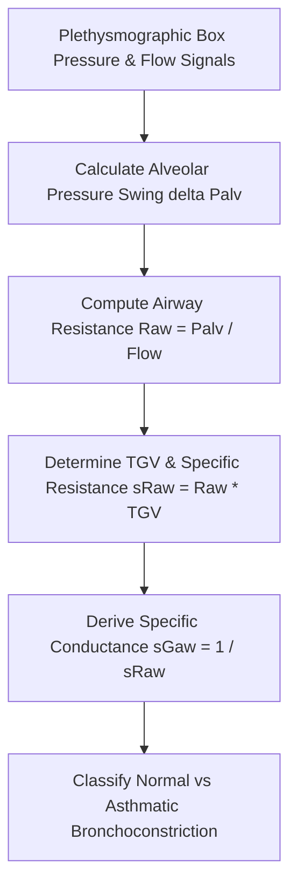

# Pulmonary Airway Resistance (Raw) Plethysmography Personal Agent Skill

[](LICENSE)
[](https://www.python.org/)
[]()
[]()
[]()

Deterministic, zero-mock personal agent micro-skill for calculating Airway Resistance ($R_{\text{aw}}$), Specific Airway Resistance ($sR_{\text{aw}}$), and Specific Airway Conductance ($sG_{\text{aw}}$) via constant-volume body plethysmography.

## Architecture



## Quickstart

```python
from client import BodyPlethysmographyRawClient

client = BodyPlethysmographyRawClient()
result = client.evaluate_airway_mechanics(
    alveolar_pressure_swing_cmh2o=1.6,
    airflow_rate_l_s=1.0,
    thoracic_gas_volume_l=3.2
)
print(result)
```

## License

Apache-2.0
